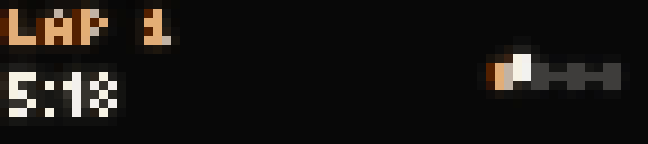

# Run Ribbon

Read the kudos count on your latest Strava activity or browse measured splits from a Garmin FIT export.

The last run stays on your desk after the watch comes off. The rear screen pairs the overall moving pace with the elapsed splits, which is handy when a stop at a crossing made one kilometer look unusually slow.

## Read your latest running session

1. Export the original FIT file into the configured folder and click the wheel to refresh.
2. Check the distance on **LAST RUN** and the date and moving pace on the rear. A cycling file in the same folder does not take over this view.
3. Turn the wheel to read the first available detail. The sample has a recorded lap at 5:18 per kilometer.


## Go back to the whole run

1. Turn back to **LAST RUN** to compare the lap with the overall effort.
2. For a file with a suitable distance trace, browse **SLOWEST KM** and the individual kilometer pages. Those splits use elapsed time and include stops.
3. Press **Start** to pin the page you want to keep after your debrief.



## Example from the emulator

The recorded test used ten kilometers in 53 minutes. That works out to five minutes and eighteen seconds per kilometer. For this file the detail came from a recorded lap. A trace with kilometer crossings can give a different picture, especially on a run with pauses. The companion read synthetic FIT files with Garmin’s official decoder.

## Set up the source

Export original FIT activities from Garmin Connect or your watch to one directory. Install the official decoder with python3 -m pip install -r companion/requirements.txt in a virtual environment. Set folder to your local directory. The first page reports moving pace. Distance traces yield elapsed one-kilometer splits, including pauses. Files without a distance trace show recorded lap pace instead. Duplicate exports count once.

## Connect the bar

Copy companion/example.json to a private config.json and adjust it for your source. From the project folder run `python3 companion/serve.py --config config.json`. Use Python 3.10+. Set Local companion URL to `http://127.0.0.1:8770/reading` on the emulator and allow local port 8770. On hardware, bind the companion to a trusted LAN interface and set its reachable address. The wheel browses pages. Click refreshes. Start pins or unpins the current page. The last good reading is labeled offline after a source error.

## Run in the emulator

Open BUSY Bar Emulator. From this repository, run:

```sh
~/.busy-emulator/bin/busy-emulator dev --once
```

Press **Back** to exit.

The GIFs are excerpts from the emulator recording. Each front-display pixel is shown at 9× its original width and height. The end frames pause for reading.

[Full recording](media/controls.mp4) · [Rear display](screenshots/back-1.png) · [Firmware test](EMULATOR-QA.md) · [MIT license](LICENSE)

## Additional source setup

Create a personal API application in Strava’s settings. Use `localhost` as the Authorization Callback Domain. Set `STRAVA_CLIENT_ID` and `STRAVA_CLIENT_SECRET` in your shell. Run `python3 companion/authorize.py`. Open its URL, allow activity read access and paste the full localhost redirect URL at the prompt, even if the browser shows a connection error. Add `--private-activities` to include your private activities. The script creates a private `tokens.json` and the companion refreshes it when needed. Strava is checked every three minutes by default. Increase `poll_seconds` for a smaller API allowance. Strava mode only uses Python’s standard library.

From the repository root, copy the example and start the companion with Python 3.10 or newer.

```sh
cp companion/live-example.json config.json
# Edit config.json for your source before starting the server.
python3 companion/serve.py --config config.json
```

In the emulator, run `~/.busy-emulator/bin/busy-emulator allow-local 8770` and approve that port. Open **Apps → Run Ribbon → Setup**, set **Local companion URL** to `http://127.0.0.1:8770/reading`, save, then reopen the app. For a physical bar, start the companion with `--host YOUR_LAN_IP` and replace `127.0.0.1` with that address. Bind only to your trusted network. Open `/reading` on the host to inspect the current reading. Keep credentials in the host environment.

## Count kudos on the latest activity

Run with the Strava config and read KUDOS. A ride, swim or walk can replace your last run. The rear gives the activity name and date. The example ride has 18 kudos.


## Check which activity was counted

Turn to ACTIVITY and compare its name and distance with your latest Strava entry. Turn back to KUDOS for the new total. Only activities visible to the authorized account and scope are included.


The recordings use example responses on emulator firmware. Each display pixel is enlarged to a 9 × 9 square.

[Strava authentication](https://developers.strava.com/docs/authentication/) · [List athlete activities](https://developers.strava.com/docs/reference/#api-Activities-getLoggedInAthleteActivities).
